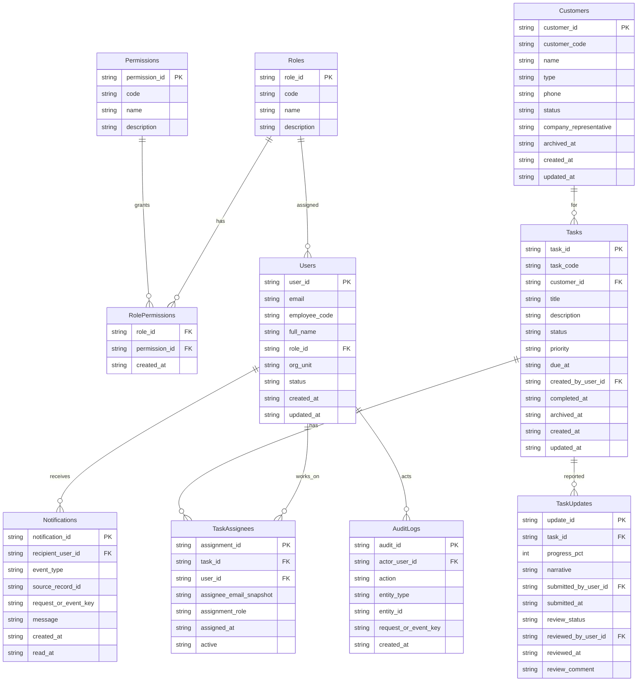

# QLCV_CBTD — Kiến trúc hệ thống (MVP)

Phạm vi: quản lý công việc của cán bộ tín dụng (CBTD) theo bộ quy tắc R1–R17 trong kế hoạch dự án. Lựa chọn nền tảng cho nhánh này (do chủ dự án chọn 08/11/2026): **Google Apps Script API + Google Sheets + SPA**, triển khai giao diện trên **Render (static site)**. Nhánh AppSheet theo quyết định 13/10/2026 không bị thay đổi; hai nhánh dùng chung mô hình dữ liệu.

## 1. Kiến trúc tổng thể

```
Trình duyệt (SPA, ES modules)
   │  Google Identity Services → ID token
   │  POST text/plain {action, idToken, params, requestId}
   ▼
Apps Script Web App  (doPost)             ← 1 endpoint duy nhất
   Router → Services → Policy (RBAC + phạm vi dòng) → Store → Driver
                                                                 │
                                                       Google Sheets (10 tab)
```

- **Xác thực**: web app chạy "execute as me, access anyone"; danh tính chỉ lấy từ ID token Google, được máy chủ kiểm tra (aud = GOOGLE_CLIENT_ID, iss, email_verified, exp, tùy chọn hd = ALLOWED_DOMAIN). Email phải khớp một người dùng `active` trong tab Users. Token được cache ≤300 giây.
- **Phân quyền**: RBAC đọc từ dữ liệu `RolePermissions` (15 quyền, 4 vai trò). CBTD chỉ thấy công việc/khách hàng thuộc phân công đang hiệu lực. Giám đốc xác định qua `DIRECTOR_EMAILS` (cấp thêm `task.transfer`, `dashboard.view_director`).
- **Ghi dữ liệu**: mọi action ghi bắt buộc `requestId` (8–64 ký tự `[A-Za-z0-9_-]`), chạy trong `LockService` và xác thực lại trong khóa; `requestId` đảm bảo idempotent (gửi lại không tạo bản ghi trùng).
- **Một mã nguồn cho ba môi trường**: cùng lõi chạy trên GAS (SheetDriver), trong trình duyệt ở chế độ demo (MemoryDriver, lưu localStorage) và trong test Node. Muốn chuyển sang PostgreSQL chỉ cần thay Driver, giữ nguyên Services/Policy.

## 2. Cấu trúc tệp

```
app/
├─ backend/
│  ├─ src/            Mã đẩy lên Apps Script (nạp theo thứ tự số)
│  │  ├─ 00_Namespace.js   Config, Enums, Schema (10 bảng)
│  │  ├─ 01_Util.js        AppError, kiểm tra dữ liệu, phân trang
│  │  ├─ 02_Store.js       Truy cập dữ liệu, bất biến, append-only, sinh mã
│  │  ├─ 10_Env_Gas.js     Lock, Cache, Properties, UrlFetch
│  │  ├─ 11_Driver_Sheet.js Đọc/ghi Google Sheets
│  │  ├─ 20_Auth_Policy.js Xác thực token, RBAC, phạm vi dòng
│  │  ├─ 30_Core.js        Audit, Notify, DTO, phân công
│  │  ├─ 40–44_Svc_*.js    Tasks, Progress, Customers, Admin, Dashboard/Notification
│  │  ├─ 90_Router.js      Bảng ACTIONS, doPost/doGet
│  │  ├─ 95_Setup.js       Khởi tạo DB, trigger, sao lưu, menu QLCV
│  │  ├─ 96_Seed.js        (sinh tự động từ CSV)
│  │  └─ appsscript.json
│  └─ dev/Env_Memory.js   Môi trường bộ nhớ (KHÔNG đẩy lên GAS)
├─ frontend/          SPA tĩnh (index.html, config.js, css/, js/, demo/)
├─ tools/build.js     seed | demo | config
├─ tests/             node:test (api, gas-runtime với Google giả lập)
├─ docs/              ARCHITECTURE, API, DEPLOYMENT
└─ render.yaml, package.json, .env.example
```

## 3. Sơ đồ cơ sở dữ liệu (Google Sheets, 10 tab)



Quy ước: tiền tố mã `USR/CUS/TSK/ASG/UPD/NTF/AUD`; mọi cột là text (`@`) để Sheets không tự đổi kiểu; cột bất biến (immutable) bị Store chặn sửa; `AuditLogs` chỉ ghi thêm. Cột bổ sung ngoài 2 danh mục gốc: `company_representative`, `archived_at` (Customers), `archived_at` (Tasks), `active`, `assignee_email_snapshot`.

### Quy tắc nghiệp vụ đã hiện thực
| Mã | Nội dung | Nơi thực thi |
|---|---|---|
| R1/R3 | Vai trò, quyền theo dữ liệu; CBTD theo phạm vi phân công | `20_Auth_Policy.js` |
| R6 | CBTD chỉ tạo việc mà mình là người chính | `40_Svc_Tasks.js` |
| R7 | Tiến độ số nguyên 0–100 kèm diễn giải (≥5 ký tự) | `41_Svc_Progress.js` |
| R8 | Duyệt 100% ⇒ tự động hoàn thành; hoàn thành là trạng thái cuối | `41_Svc_Progress.js` |
| R10 | Maker–checker: không tự duyệt báo cáo của mình (`SELF_REVIEW`) | `41_Svc_Progress.js` |
| R11 | Thông báo trong ứng dụng (khóa sự kiện chống trùng) | `30_Core.js` |
| R12 | Nhật ký kiểm toán chỉ ghi thêm | `02_Store.js`, `30_Core.js` |
| R15 | Bảng điều khiển Giám đốc | `44_Svc_Dashboard.js` |
| R16 | Kiểm tra toàn vẹn, đối soát, sao lưu hằng ngày | `43_Svc_Admin.js`, `95_Setup.js` |
| R17 | Chuyển giao người chính; người đại diện chỉ cho khách doanh nghiệp | `40`, `42` |

## 4. Kiến trúc giao diện

- SPA thuần ES modules, router theo hash (`#/tasks/TSK-001`), không phụ thuộc thư viện.
- `ui.js`: hàm dựng DOM an toàn `h()` (không dùng innerHTML với dữ liệu người dùng), nhãn tiếng Việt, thành phần KPI/badge/trạng thái, `formDialog` (hiện lỗi từng ô từ API, `showIf`, `range`), `confirmDialog`, toast.
- `api.js`: `call(action, params)`; tái sử dụng `requestId` khi thử lại; chế độ demo nạp backend gói sẵn trong trình duyệt.
- `auth.js`: Google Identity Services (live) hoặc chọn người dùng mẫu (demo).
- Trang vào theo vai trò: CBTD → Công việc; KSV → Duyệt tiến độ; BGD → Bảng điều khiển; Admin → Quản trị. Menu ẩn/hiện theo quyền trả về từ `auth.me`.
- Bố cục thích ứng: bảng chuyển thành thẻ ở màn hình hẹp (đã kiểm tra 390 px, không tràn ngang). CSP khai báo trong `index.html`.

## 5. Bảo mật
- Không có bí mật phía trình duyệt; Client ID là thông tin công khai.
- Kiểm tra mọi tham số ở máy chủ (độ dài, kiểu, danh mục); giới hạn thân yêu cầu 64 KB và 240 yêu cầu/phút/người.
- Lỗi nội bộ trả mã `INTERNAL`, không lộ chi tiết; chi tiết lỗi chỉ nằm trong nhật ký của Apps Script.
- Dữ liệu thật bị chặn theo R13 cho đến khi được phê duyệt an toàn thông tin: `seedDemoData` cần `ALLOW_SEED=true` và từ chối chạy khi đã có dữ liệu.

## 6. Giới hạn đã biết và lộ trình mở rộng
- Google Sheets phù hợp quy mô nhỏ–vừa (hàng chục nghìn dòng, vài chục người dùng đồng thời); ghi tuần tự dưới khóa script nên có thể trả `BUSY` khi tải cao — giao diện cho phép thử lại với cùng `requestId`.
- Chưa kiểm thử với dịch vụ Google thật (chỉ giả lập và chế độ demo). Cần thử nghiệm UAT sau khi triển khai.
- `admin.restore` chưa bật (`NOT_ENABLED`); bản sao lưu hằng ngày có sẵn, khôi phục thực hiện thủ công.
- Giám đốc xác định bằng `DIRECTOR_EMAILS` do thông số kỹ thuật còn chờ xác nhận quyền BGD.
- Lộ trình: (1) thay `SheetDriver` bằng driver PostgreSQL/Cloud SQL, đưa Router vào Cloud Run; (2) thêm email/Chat cho thông báo; (3) tệp đính kèm bằng Drive; (4) báo cáo xuất Excel.
