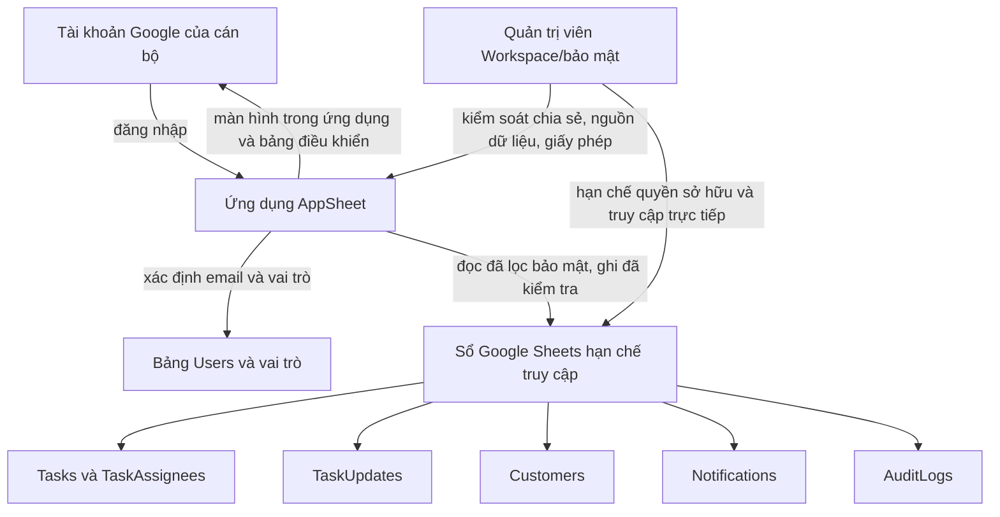
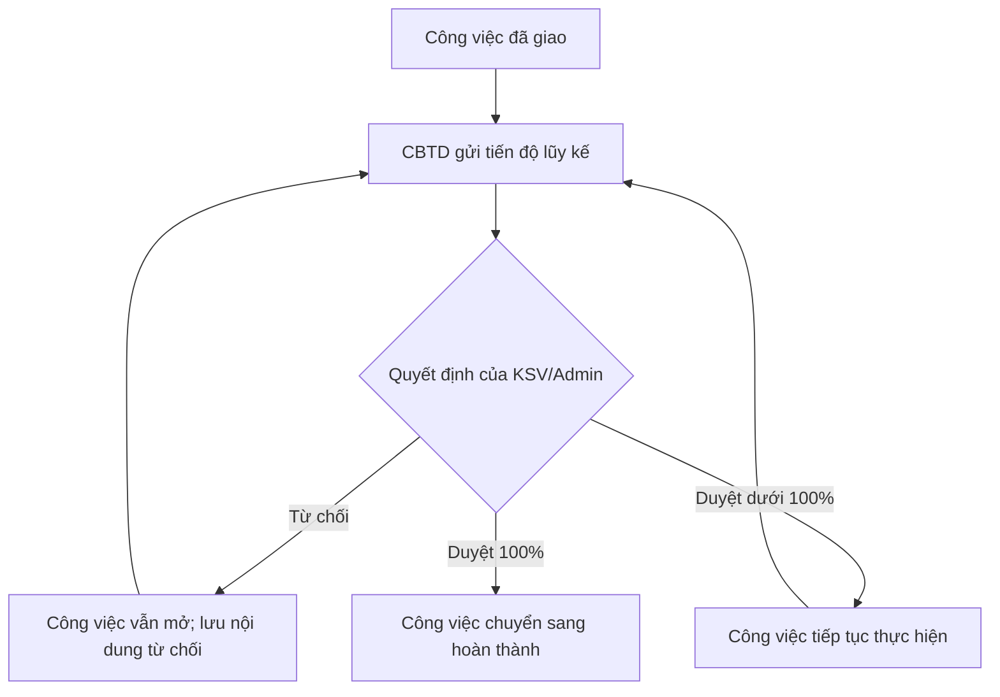

# Kế hoạch ứng dụng quản lý công việc AppSheet

## Tóm tắt mục tiêu

- **Mục tiêu:** Cán bộ có thể giao việc, theo dõi công việc, gửi tiến độ để duyệt và xem thông tin khách hàng cũng như khối lượng công việc phù hợp với vai trò trong một ứng dụng được kiểm soát.
- **Phương thức:** Xây dựng một ứng dụng AppSheet riêng, sử dụng Google Sheets làm sổ dữ liệu, theo [migration-spec.md](../../migration-spec.md) và các quy tắc nghiệp vụ đã xác nhận trong kế hoạch này.
- **Nguồn quyết định:** Các quyết định người dùng đã xác nhận trong kế hoạch này chi phối hành vi; mô hình dữ liệu đề xuất trong [migration-spec.md](../../migration-spec.md) chi phối các trường dữ liệu, trừ phần kế hoạch này nêu rõ là mở rộng; [business_logic.md](../solutions/business_logic.md) và [SPECIFICATION_v2.md](../solutions/SPECIFICATION_v2.md) cung cấp bối cảnh quy trình cũ; các điểm khác biệt được nêu rõ bên dưới.
- **Điều kiện dừng:** Không nạp dữ liệu khách hàng hoặc dữ liệu tín dụng thật cho đến khi quản trị viên Workspace/bảo mật và chủ sở hữu dữ liệu nghiệp vụ phê duyệt gói AppSheet, mô hình truy cập, quyền đối với tệp nguồn, kiểm soát thiết bị/bộ nhớ đệm và thời hạn lưu nhật ký kiểm toán bắt buộc (R13).
- **Môi trường thực hiện:** Trình biên tập AppSheet và Google Sheets trong Workspace của tổ chức. Trước khi triển khai với dữ liệu thật, phải chỉ định chủ sở hữu ứng dụng, biên tập viên dự phòng, chủ sở hữu dữ liệu, người rà soát bảo mật và chủ đơn vị thí điểm; tài liệu nguồn chưa xác định những người này.
- **Bàn giao:** Nhóm triển khai bàn giao sổ dữ liệu, cấu hình ứng dụng, bằng chứng kiểm thử và hướng dẫn vận hành. Không thay đổi ứng dụng mẫu React/Express hiện tại.

## Hợp đồng sản phẩm

### Tóm tắt

Tạo ứng dụng AppSheet quản lý công việc cho quy trình QLCV CBTD, gồm giao việc, tra cứu khách hàng, duyệt tiến độ, truy cập theo vai trò, hộp thông báo trong ứng dụng, nhật ký kiểm toán và bảng điều khiển công việc. Trong giai đoạn thí điểm, chỉ dùng dữ liệu tổng hợp hoặc dữ liệu khách hàng đã được che và phê duyệt; chỉ được dùng dữ liệu khách hàng thật sau khi vượt qua cổng phê duyệt bảo mật và chủ sở hữu dữ liệu tại R13.

### Bối cảnh vấn đề

Ứng dụng React/Express hiện tại là bản mẫu, dùng dữ liệu công việc/khách hàng trong bộ nhớ và đăng nhập giả lập nên chưa hỗ trợ vận hành nhiều người dùng với dữ liệu lưu bền vững. Tài liệu quy trình cũ mô tả nghiệp vụ mà ứng dụng mới cần giữ lại, nhưng bản mẫu hiện tại chưa triển khai các nghiệp vụ đó. Vì vậy, kế hoạch AppSheet cần kết nối mô hình dữ liệu đề xuất với quy trình đã tài liệu hóa, không coi dữ liệu mẫu của bản mẫu là dữ liệu sản xuất.

### Yêu cầu

#### Danh tính, dữ liệu và truy cập

- R1. Bắt buộc đăng nhập bằng danh tính Google; chỉ cấp quyền cho danh sách cán bộ hoặc nhóm Workspace đã được phê duyệt; ánh xạ email đăng nhập sang một dòng `Users` đang hoạt động và vai trò nghiệp vụ tương ứng.
- R2. Lưu dữ liệu vận hành trong một sổ Google Sheets được kiểm soát, dùng khóa duy nhất ổn định và tham chiếu tường minh; không dùng vị trí dòng làm khóa bản ghi.
- R3. Thực thi quyền đọc/ghi theo vai trò và phạm vi bản ghi ở cấp dữ liệu/hành động đối với công việc, cập nhật tiến độ, khách hàng, thông báo và nhật ký kiểm toán; ẩn màn hình hoặc nút thao tác không phải là cơ chế phân quyền. CBTD chỉ xem công việc được giao và các dòng khách hàng liên kết với công việc đó.
- R4. Chỉ chủ sở hữu/người quản lý được phê duyệt mới có quyền truy cập sổ dữ liệu và quyền biên tập ứng dụng AppSheet; người dùng ứng dụng chỉ được dùng ứng dụng, không được quyền biên tập hay truy cập trực tiếp bảng tính, trừ khi quản trị viên Workspace/bảo mật có phê duyệt khác.

#### Công việc và nghiệp vụ khách hàng

- R5. Hỗ trợ tạo, xem, cập nhật và lưu trữ công việc; mỗi công việc liên kết với khách hàng, có một CBTD chính, một CBTD phối hợp tùy chọn, trạng thái, mức ưu tiên, hạn xử lý và thông tin người tạo. Giữ lại dòng công việc được tham chiếu bởi lịch sử tiến độ hoặc nhật ký kiểm toán. CBTD được giao việc có thể chuyển việc được giao sang trạng thái Đang thực hiện khi bắt đầu, nhưng không được tự chuyển sang `completed`.
- R6. CBTD chỉ được tạo công việc khi chính CBTD đó được gán làm người phụ trách chính; Admin, KSV và BGD được tạo và giao việc theo ma trận vai trò trong kế hoạch này.
- R7. CBTD được giao việc có thể gửi phần trăm tiến độ lũy kế dạng số từ 0 đến 100 kèm nội dung diễn giải; KSV/Admin được duyệt hoặc từ chối cập nhật đã gửi; cập nhật bị từ chối vẫn được lưu trong lịch sử.
- R8. Khi người duyệt có thẩm quyền chấp thuận cập nhật tiến độ 100%, tự động chuyển công việc sang `completed`; không yêu cầu thêm một thao tác hoàn thành thủ công.
- R9. Cung cấp tra cứu khách hàng và chức năng để KSV duy trì hồ sơ khách hàng theo các trường đã thống nhất cho thí điểm; không đưa dư nợ hoặc thông tin chi tiết trong hồ sơ tín dụng vào phạm vi này.
- R10. Cung cấp số liệu tổng hợp về công việc theo trạng thái, công việc quá hạn, lượt duyệt đang chờ, tiến độ đã được duyệt và số lượng khách hàng; mọi số liệu chỉ tính trên các bản ghi mà người dùng hiện tại được phép xem.

#### Thông báo, kiểm toán và triển khai

- R11. Cung cấp hộp thông báo trong ứng dụng cho các sự kiện giao việc, gửi tiến độ cần duyệt và kết quả duyệt/từ chối; không triển khai thông báo qua email, SMS hoặc thông báo đẩy trong kế hoạch này.
- R12. Ghi nhận các thao tác quan trọng về công việc, khách hàng, người dùng/vai trò, phân công và duyệt với người thực hiện, hành động, khóa bản ghi và thời điểm trong bảng nhật ký kiểm toán của ứng dụng; không ghi thông tin xác thực, token, chi tiết khách hàng hoặc ảnh chụp toàn bộ bản ghi nhạy cảm vào nội dung nhật ký/thông báo.
- R13. Dùng dữ liệu tổng hợp hoặc dữ liệu khách hàng đã được che và phê duyệt trong quá trình xây dựng và kiểm thử thí điểm; chỉ nạp dữ liệu thật sau khi vượt qua cổng bảo mật/chủ sở hữu dữ liệu và các kiểm soát đối soát trong U7.
- R14. Cung cấp màn hình đầu và điều hướng theo vai trò Admin, BGD, KSV, CBTD; trạng thái trống phải nêu rằng không có bản ghi được phép xem và bước tiếp theo được phép; trạng thái lỗi phải hiển thị rõ, có thao tác thử lại và hướng báo lỗi nếu sự cố tiếp diễn. Các màn hình/hành động phải phản ánh nhưng không thay thế quyền phân quyền tại R3.

#### Phân quyền và cấu hình UX bổ sung

- R15. Tạo Dashboard công việc ưu tiên cho Giám đốc bằng các view dựa trên Slice có điều kiện lọc dưới đây; chỉ hiển thị Dashboard cho `Giam_Doc` và `Admin`.

```text
Row filter condition:
AND(OR([Muc_Do_Uu_Tien] = "Khan", [Muc_Do_Uu_Tien] = "Quan_Trong", [Ngay_Het_Han] < TODAY()), [Trang_Thai] <> "Hoàn thành")

View Show If:
OR(LOOKUP(USEREMAIL(), "Nhan_Su", "Email", "Vai_Tro") = "Giam_Doc", LOOKUP(USEREMAIL(), "Nhan_Su", "Email", "Vai_Tro") = "Admin")
```

- R16. Admin có toàn quyền nghiệp vụ trong ứng dụng, bao gồm thêm/sửa/xóa dòng `Nhan_Su` và sử dụng Backup/Restore; xóa người dùng không được xóa dây chuyền lịch sử/phân công, sửa/xóa nhật ký kiểm toán hoặc mở rộng quyền Workspace/AppSheet editor theo R4.

```text
Show If for user management and Backup/Restore:
LOOKUP(USEREMAIL(), "Nhan_Su", "Email", "Vai_Tro") = "Admin"
```

- R17. Chỉ hiện `Nguoi_Dai_Dien_Cty` khi loại khách hàng là công ty; tạo Action cập nhật `Nguoi_Thuc_Hien` và chỉ hiện Action cho Giám đốc, KSV hoặc Admin.

```text
Show If for Nguoi_Dai_Dien_Cty:
[Loai_Khach_Hang] = "Cong_Ty"

Show If for reassignment Action:
IN(LOOKUP(USEREMAIL(), "Nhan_Su", "Email", "Vai_Tro"), LIST("Giam_Doc", "KSV", "Admin"))
```

### Các quyết định đã thống nhất

- **Chỉ thông báo trong ứng dụng** (quyết định đã thống nhất trong phiên: người dùng phê duyệt — chọn phương án này thay vì bổ sung email/SMS để bản phát hành đầu tiên nằm trong phạm vi quy trình AppSheet đã thống nhất). Chi phối R11.
- **Tự động hoàn thành khi cập nhật 100% được duyệt** (quyết định đã thống nhất trong phiên: người dùng phê duyệt — chọn phương án này thay vì thêm thao tác hoàn thành riêng của KSV/Admin, tránh lặp bước đổi trạng thái). Chi phối R7, R8.
- **CBTD chỉ xem khách hàng gắn với công việc được giao** (quyết định đã thống nhất trong phiên: người dùng phê duyệt — chọn phương án này thay vì cho xem toàn bộ danh sách khách hàng, giới hạn quyền truy cập theo phạm vi công việc). Chi phối R3, R9.
- **Báo cáo tiến độ dùng phần trăm lũy kế dạng số từ 0 đến 100** (quyết định đã thống nhất trong phiên: người dùng phê duyệt — chọn phương án này thay vì chỉ báo cáo bằng diễn giải để ngưỡng hoàn thành rõ ràng và kiểm thử được). Chi phối R7, R8.
- **CBTD chỉ được tạo công việc nếu tự nhận vai trò CBTD chính** (quyết định đã thống nhất trong phiên: người dùng chỉ đạo — chọn phương án này thay vì giới hạn quyền tạo việc cho Admin/KSV/BGD, giữ hành vi cũ cho phép CBTD tự nhận việc). Chi phối R5, R6.
- **CBTD được giao việc có thể chuyển công việc được giao sang Đang thực hiện nhưng không được tự hoàn thành** (quyết định đã thống nhất trong phiên: người dùng phê duyệt — chọn phương án này thay vì cho phép tự hoàn thành hoặc để quyền đổi trạng thái chưa xác định). Chi phối R5, R8.
- **Màn hình đầu và trạng thái khôi phục theo vai trò** (quyết định đã thống nhất trong phiên: người dùng phê duyệt — CBTD mở danh sách việc được giao, KSV mở danh sách báo cáo chờ duyệt, Admin mở màn hình quản trị, BGD mở tổng quan khối lượng công việc chỉ đọc; quyền tạo/giao việc hiện có của BGD vẫn dùng được qua điều hướng công việc được phép). Chi phối R14.
- **Admin có toàn quyền nghiệp vụ nhưng không xóa lịch sử/nhật ký** (session-settled: user-directed — chosen over allowing permanent deletion of history: giữ quyền thao tác trong ứng dụng mà vẫn bảo toàn kiểm toán và lịch sử). Chi phối R12, R16.

### Đối tượng sử dụng

- A1. **Admin:** có toàn quyền nghiệp vụ trong ứng dụng, quản lý người dùng và vai trò, xem tất cả bản ghi thí điểm trừ thông báo của người nhận khác; không sửa/xóa nhật ký kiểm toán hoặc lịch sử được bảo vệ.
- A2. **BGD:** tạo/giao việc và xem báo cáo khối lượng công việc ở cấp tổ chức trong phạm vi thí điểm đã duyệt.
- A3. **KSV:** tạo/giao việc, duy trì hồ sơ khách hàng, duyệt hoặc từ chối báo cáo tiến độ.
- A4. **CBTD:** xem công việc được giao và dữ liệu khách hàng liên quan, gửi báo cáo tiến độ, có thể tạo công việc nếu tự nhận làm CBTD chính.
- A5. **Chủ ứng dụng/quản trị viên Workspace-bảo mật:** cấu hình danh tính, chia sẻ, quyền truy cập nguồn dữ liệu, giấy phép, thời hạn lưu trữ và kiểm soát thiết bị. Đây là trách nhiệm vận hành, không phải vai trò nghiệp vụ trong AppSheet.

### Các luồng chính

- F1. **Tạo và giao việc:** A1/A2/A3 tạo công việc, giao một CBTD chính và một CBTD phối hợp tùy chọn; A4 chỉ được tạo công việc nếu tự làm CBTD chính; công việc chỉ xuất hiện trong màn hình mà người dùng được phép truy cập.
- F2. **Gửi và duyệt tiến độ:** A4 có thể chuyển công việc được giao sang Đang thực hiện khi bắt đầu và gửi báo cáo lũy kế từ 0–100; A4 không được tự hoàn thành công việc. A3/A1 duyệt hoặc từ chối; khi từ chối phải lưu báo cáo và lý do; khi duyệt tiến độ 100% thì công việc hoàn thành.
- F3. **Tra cứu khách hàng và xem bảng điều khiển:** A4 chỉ xem khách hàng gắn với công việc được giao; A1/A2/A3 xem tập dữ liệu thí điểm rộng hơn đã được duyệt; số liệu trên bảng điều khiển tuân theo cùng phạm vi hiển thị với dữ liệu nguồn.
- F4. **Thông báo và kiểm toán:** sự kiện thuộc phạm vi tạo thông báo trong ứng dụng cho đúng người nhận và ghi nhật ký kiểm toán cho hành động quan trọng; nội dung thông báo không chứa chi tiết khách hàng nhạy cảm.
- F5. **Điều hướng theo vai trò:** A4 vào màn hình công việc được giao, A3 vào báo cáo chờ duyệt, A1 vào màn hình quản trị, A2 vào tổng quan khối lượng công việc chỉ đọc. Điều hướng chỉ hiển thị màn hình/hành động được phép theo vai trò; quyền tạo/giao việc hiện có của A2 vẫn dùng được ngoài màn hình tổng quan chỉ đọc. Trạng thái trống nêu rằng không có bản ghi được phép xem và bước tiếp theo; trạng thái lỗi hiển thị rõ, có thao tác thử lại và hướng báo lỗi nếu sự cố tiếp diễn.

### Ví dụ nghiệm thu

- AE1. Với người dùng chưa được chia sẻ ứng dụng hoặc không có dòng `Users` đang hoạt động, khi mở ứng dụng thì bị từ chối truy cập và không để lộ dữ liệu trong sổ.
- AE2. Với CBTD được giao Công việc A nhưng không được giao Công việc B, khi mở màn hình hoặc đồng bộ công việc/khách hàng thì không thấy Công việc B và khách hàng không liên quan đến Công việc A; khi tạo công việc thì CBTD đó phải là người phụ trách chính.
- AE3. Với công việc được giao, khi CBTD gửi tiến độ 100% và KSV/Admin duyệt thì công việc chuyển sang `completed`; nếu người duyệt từ chối cập nhật thì công việc không hoàn thành và lý do từ chối được lưu để người có quyền xem.
- AE4. Với sự kiện giao việc, gửi tiến độ hoặc quyết định duyệt, khi sự kiện được ghi nhận thì chỉ người nhận dự kiến nhận thông báo trong ứng dụng và hành động quan trọng được ghi nhận trong nhật ký kiểm toán.
- AE5. Với sổ thí điểm được kiểm soát, khi người không có quyền bảng tính truy cập trực tiếp thì bị từ chối; khi người được phép đồng bộ ứng dụng thì chỉ nhận các dòng được phép theo vai trò và phạm vi phân công.
- AE6. Với công việc được giao, khi CBTD bắt đầu thì có thể chuyển việc sang Đang thực hiện; thao tác tự chuyển sang `completed` bị từ chối và chỉ luồng duyệt báo cáo tiến độ 100% có thẩm quyền mới hoàn thành việc.
- AE7. Với tài khoản Admin, BGD, KSV hoặc CBTD, khi mở ứng dụng thì hiển thị đúng màn hình đầu theo vai trò đã thống nhất; màn hình tổng quan của BGD chỉ đọc nhưng quyền tạo/giao việc được phép vẫn truy cập qua điều hướng công việc. Khi màn hình không có bản ghi được phép xem, ứng dụng nêu rõ tình trạng và bước tiếp theo; khi tải lỗi, ứng dụng thông báo rõ, có thao tác thử lại và hướng báo lỗi nếu sự cố tiếp diễn mà không để lộ dòng trái phép.
- AE8. Với công việc ưu tiên khẩn/cần thiết chưa hoàn thành và công việc quá hạn chưa hoàn thành, khi mở Dashboard thì các dòng phù hợp điều kiện R15 được đưa vào; công việc đã hoàn thành và công việc thường chưa đến hạn bị loại. Ngày đến hạn bằng hôm nay không được tính là quá hạn bởi phép so sánh `< TODAY()`.
- AE9. Với tài khoản Admin, khi thêm/sửa/xóa người dùng hoặc chạy Backup/Restore thì thao tác được phép và các nút quản trị hiển thị; với tài khoản `Giam_Doc`, KSV, CBTD hoặc chưa ánh xạ vai trò thì các nút ẩn và thao tác bị từ chối.
- AE10. Với hồ sơ khách hàng, khi `Loai_Khach_Hang` là `Cong_Ty` thì trường đại diện hiện, còn loại khác thì trường ẩn; Action chuyển giao cập nhật `Nguoi_Thuc_Hien` cho `Giam_Doc`, KSV và Admin, nhưng không hiển thị hoặc cho phép CBTD thực hiện.

### Tiêu chí thành công

| Mục tiêu | KPI / tín hiệu nghiệm thu | Người chịu trách nhiệm | Hành động / hạn hoàn thành | Bằng chứng | Kiểm tra | Đánh giá |
|---|---|---|---|---|---|---|
| Bảo vệ quyền truy cập ứng dụng và sổ dữ liệu | 100% tình huống tài khoản/vai trò trong ma trận nghiệm thu đạt; 0 dòng trái phép bị xem hoặc tải xuống trong kiểm thử CBTD | Chủ ứng dụng + quản trị viên Workspace/bảo mật | Cấu hình đăng nhập, chia sẻ, quyền nguồn và bộ lọc trước khi dùng dữ liệu thật; ngày cụ thể TBD | Ma trận truy cập đã ký và kết quả kiểm thử | Kiểm thử tài khoản chưa được chia sẻ, tài khoản không hoạt động, từng vai trò, truy cập trực tiếp sổ và quyền biên tập | Không dùng dữ liệu sản xuất cho đến khi mọi kiểm thử truy cập đạt |
| Giữ đúng quy trình nghiệp vụ | 100% tình huống tạo/giao/báo cáo/từ chối/duyệt/tự hoàn thành và điều hướng theo vai trò đạt; 0 phân công chính trùng lặp hoặc khóa trùng trong bộ dữ liệu thí điểm | Chủ quy trình nghiệp vụ + người xây dựng AppSheet | Triển khai U1–U4 trước nghiệm thu thí điểm | Kết quả tình huống AppSheet và báo cáo toàn vẹn sổ dữ liệu | Kiểm tra từng chuyển trạng thái và màn hình đầu/trạng thái trống/lỗi bằng tài khoản vai trò riêng, gồm cả tình huống thử lại | Chỉ nghiệm thu thí điểm khi tất cả tình huống đạt |
| Truy xuất được thay đổi | 100% thao tác quan trọng được kiểm thử có người thực hiện, hành động, khóa bản ghi và thời điểm; 0 chi tiết khách hàng trong nội dung thông báo/kiểm toán | Chủ dữ liệu + người xây dựng AppSheet | Triển khai U6 và xác nhận thời hạn lưu nhật ký trước khi dùng dữ liệu thật; ngày cụ thể TBD | Mẫu nhật ký và quyết định lưu trữ | Đối chiếu sự kiện dự kiến với dòng nhật ký, kiểm tra nội dung thông báo/kiểm toán | Nếu yêu cầu lưu trữ vượt khả năng giải pháp được duyệt thì dừng phát hành với dữ liệu thật |
| Đảm bảo hiệu năng và đồng bộ có thể chấp nhận | Ghi nhận p50/p95 thời gian đồng bộ và tỷ lệ lỗi trên bộ dữ liệu cao điểm đại diện đã được chủ sở hữu duyệt; chủ sở hữu xác định ngưỡng chấp nhận trước thí điểm dữ liệu thật | Người xây dựng AppSheet + chủ thí điểm | Đo cơ sở trong U7; thống nhất ngưỡng trước khi nạp dữ liệu thật | Báo cáo kiểm thử gồm số dòng, thiết bị, p50/p95 và lỗi | Chạy lại sau khi nạp cấu hình bộ lọc bảo mật và dữ liệu đại diện | Không tự đặt ngưỡng độ trễ; chỉ tiếp tục khi chủ sở hữu chấp thuận số đo |
| Đối soát dữ liệu thí điểm | 100% dòng nạp có khóa duy nhất và tham chiếu hợp lệ; 0 ánh xạ trùng hoặc mơ hồ chưa xử lý | Chủ dữ liệu + đầu mối migration | Chỉ nạp dữ liệu thí điểm đã duyệt trong U7; ngày cụ thể TBD | Sổ ánh xạ, số lượng nguồn/đích và danh sách ngoại lệ | Đối chiếu tổng số và lấy mẫu người dùng, công việc, phân công, cập nhật và khách hàng | Ngoại lệ chưa xử lý không được nạp và chặn tập bản ghi liên quan |
| UX và quyền theo vai trò | 100% tình huống Dashboard Giám đốc, CRUD `Nhan_Su`, Backup/Restore, trường đại diện và chuyển giao đạt; 0 thao tác trái quyền ghi thành công | Chủ ứng dụng + quản trị viên Workspace/bảo mật + chủ quy trình | Hoàn tất cấu hình và kiểm thử U2, U3, U5 trước nghiệm thu U7 | Ma trận quyền và kết quả kiểm thử từng vai trò | Kiểm tra biểu thức, dữ liệu được lọc, nút hiển thị và quyền thực thi bằng tài khoản riêng | Chặn nghiệm thu nếu sai vai trò, sai bộ lọc hoặc còn thao tác trái quyền |

### Ranh giới phạm vi

#### Trong phạm vi

- Một ứng dụng AppSheet và một sổ Google Sheets riêng cho thí điểm QLCV CBTD được kiểm soát.
- Dữ liệu người dùng, vai trò, quyền, khách hàng, công việc, phân công công việc, cập nhật tiến độ, thông báo và kiểm toán.
- Biểu mẫu, màn hình, hành động AppSheet, bộ lọc theo vai trò/dòng, bảng điều khiển công việc và hộp thông báo trong ứng dụng.
- Dashboard ưu tiên cho Giám đốc, quản trị người dùng `Nhan_Su`, nút Backup/Restore, trường đại diện công ty và Action chuyển giao `Nguoi_Thuc_Hien`.
- Dữ liệu kiểm thử tổng hợp hoặc dữ liệu khách hàng đã được che và phê duyệt, kiểm soát ánh xạ migration, kiểm thử nghiệm thu và tài liệu bàn giao.

#### Để giai đoạn tiếp theo

- Chuyển đổi dữ liệu sản xuất sau khi phê duyệt chủ sở hữu nguồn, thời hạn lưu trữ và bảo mật.
- Thông báo email, SMS và thông báo đẩy.
- Dữ liệu chi tiết về khoản vay, tài sản bảo đảm, nợ quá hạn, AML/KYC và quyết định tín dụng.
- Triển khai nhiều chi nhánh nếu vượt quá phạm vi thí điểm được duyệt.
- Ngừng ứng dụng mẫu React/Express sau khi thí điểm AppSheet được nghiệm thu và chủ sở hữu có quyết định riêng.

#### Ngoài mục tiêu

- Thay thế phương án AppSheet + Google Sheets mà người dùng đã chọn bằng một cơ sở dữ liệu khác trong kế hoạch này. Phương án đã chọn bị giới hạn bởi cổng phê duyệt bảo mật và dữ liệu tại R13.
- Xây dựng lại giao diện hoặc backend React/Express hiện tại trong khuôn khổ thí điểm AppSheet.
- Xây mới dịch vụ Backup/Restore; R16 chỉ bật nút sau khi xác nhận handler hiện có và kiểm thử phục hồi dữ liệu tổng hợp.
- Coi AppSheet Audit History là kho lưu trữ nhật ký kiểm toán nghiệp vụ lâu dài duy nhất.
- Nạp dữ liệu khách hàng hoặc tín dụng có thể nhận diện trước khi tổ chức phê duyệt rõ ràng.

### Phụ thuộc

- Tài khoản Google Workspace do tổ chức quản lý, gói/giấy phép AppSheet được duyệt cho chủ ứng dụng và từng người dùng thí điểm, cùng nhà cung cấp danh tính trả về email đăng nhập.
- Có tên quản trị viên Workspace/bảo mật, chủ ứng dụng và người dự phòng, chủ dữ liệu nghiệp vụ, chủ đơn vị thí điểm và người duyệt nghiệm thu.
- Có dữ liệu nguồn khách hàng/công việc được duyệt và người phụ trách ánh xạ; kho mã hiện tại chỉ có dữ liệu mẫu và tài liệu cũ, không có bộ dữ liệu sản xuất có thẩm quyền.

### Câu hỏi còn mở

- Đơn vị thí điểm và tài khoản người dùng cụ thể là những ai; ai là KSV duyệt từng công việc? **Làm rõ trước khi mời người dùng thí điểm.**
- Tổ chức có phiên bản Workspace/AppSheet và giấy phép từng người dùng nào; chế độ truy cập nguồn dữ liệu AppSheet nào được duyệt? **Làm rõ trước khi bật truy cập dữ liệu thật.**
- Tổ chức yêu cầu thời hạn lưu nhật ký, quản lý thiết bị, bộ nhớ đệm cục bộ và kiểm soát chia sẻ dữ liệu như thế nào? **Làm rõ trước khi dùng dữ liệu sản xuất.**
- Có được mở lại hoặc sửa công việc đã hoàn thành không, và vai trò nào có quyền? **Chờ chủ quy trình nghiệp vụ xác nhận; mặc định thí điểm là hoàn thành không thể đảo ngược, sai sót cần tạo công việc/cập nhật tiếp theo.**
- Phạm vi hiển thị thí điểm có chủ ý chỉ giới hạn trong một đơn vị không? **Giả định cho giai đoạn đầu; xác nhận trước khi mở rộng chia sẻ hoặc phạm vi dữ liệu.**
- Bảng AppSheet `Nhan_Su` có phải bảng người dùng logic `Users` và giá trị `Giam_Doc` có phải mã vai trò tương ứng với `BGD` trong ma trận hiện tại không? **Xác nhận tên bảng, mã vai trò và giá trị thô của `Trang_Thai` trước khi bật các biểu thức R15–R17; không tự thay chuỗi điều kiện.**
- Cột AppSheet `Nguoi_Thuc_Hien` ánh xạ vào người phụ trách chính trong `TaskAssignees` hay là cột vật lý khác? **Xác nhận đích cập nhật trước khi bật Action R17 để không ghi sai người phụ trách hoặc làm mất CBTD phối hợp.**
- Nút Backup/Restore hiện tại sẽ gọi hành động hoặc quy trình nguồn dữ liệu nào? **Xác nhận handler và thử phục hồi trên dữ liệu tổng hợp trước khi bật nút. Nếu không có handler được duyệt, R16/U7 bị chặn cho đến khi chủ sản phẩm phê duyệt mở rộng phạm vi để xây dịch vụ hoặc bỏ Backup/Restore khỏi thí điểm; kế hoạch hiện tại không tự xây dịch vụ mới.**
- Admin có được thay đổi vai trò hoặc trạng thái tài khoản của chính mình, bao gồm tự cấp vai trò Admin không? **Chốt người có thẩm quyền cấp/thu hồi vai trò Admin và cấm tự nâng quyền nếu không có phê duyệt độc lập trước khi bật CRUD `Nhan_Su`.**
- Khi Admin xóa người dùng còn công việc đang được giao, phải chặn xóa đến khi phân công lại hay chuyển tài khoản sang trạng thái ngừng hoạt động? **Chốt luồng xử lý trước khi bật xóa để tránh phân công đang hoạt động trỏ tới người dùng không còn truy cập được.**
- Khi đổi loại khách hàng khỏi `Cong_Ty`, có cần xóa giá trị `Nguoi_Dai_Dien_Cty` đã lưu hay chỉ ẩn trường? **R17 chỉ quy định hiển thị; chốt chính sách dữ liệu với chủ dữ liệu trước khi cấu hình biểu mẫu.**

## Hợp đồng lập kế hoạch

### Các quyết định kỹ thuật trọng yếu

- KTD1. **Dùng AppSheet + Google Sheets cho thí điểm được yêu cầu, nhưng đặt cổng trước khi dùng dữ liệu thật.** Google nêu rõ bộ lọc bảo mật không phải giải pháp bảo mật toàn diện, ứng dụng dùng bảng tính có thể truy xuất sổ trước khi lọc và ứng dụng di động lưu dữ liệu đệm khi ngoại tuyến/đường truyền gián đoạn. Các điểm này không loại bỏ phương án thí điểm đã chọn, nhưng bộ lọc dòng không đủ để phê duyệt dùng dữ liệu sản xuất. Quản trị viên Workspace/bảo mật phải duyệt chế độ truy cập thực tế, quyền tệp nguồn, giấy phép, chính sách thiết bị/bộ nhớ đệm và thời hạn lưu trữ trước khi R13 cho phép dùng dữ liệu thật. Nếu không đáp ứng chính sách, dừng triển khai với dữ liệu thật và trình lại quyết định cho người dùng; không tự ý thay bằng cơ sở dữ liệu khác. Nguồn: [Bộ lọc bảo mật](https://support.google.com/appsheet/answer/10104706?hl=en), [Ngoại tuyến và đồng bộ](https://support.google.com/appsheet/answer/10107724?hl=en), [Lưu bộ nhớ đệm ngoại tuyến](https://support.google.com/appsheet/answer/10108551?hl=en), [Chia sẻ ứng dụng](https://support.google.com/appsheet/answer/10104983?hl=en).
- KTD2. **Dùng danh tính đã đăng nhập kết hợp vai trò nghiệp vụ trong ứng dụng và bộ lọc bảo mật.** Bắt buộc đăng nhập và chỉ chia sẻ ứng dụng cho cán bộ được nêu tên hoặc nhóm Workspace được duyệt. Ánh xạ `USEREMAIL()` vào một bản ghi `Users` đang hoạt động; dùng security filters để giới hạn dòng được gửi đến ứng dụng, còn slices chỉ để định hình màn hình, không dùng làm ranh giới bảo mật thông tin. Chỉ cấp quyền biên tập ứng dụng cho chủ sở hữu đáng tin cậy. Ưu tiên chế độ nguồn dữ liệu không cấp cho CBTD quyền trực tiếp vào bảng tính; nếu chế độ được duyệt đòi hỏi quyền đó, tạm dừng và xin quản trị viên phê duyệt. Nguồn: [Bắt buộc đăng nhập](https://support.google.com/appsheet/answer/10104975?hl=en), [Chia sẻ ứng dụng](https://support.google.com/appsheet/answer/10104983?hl=en), [Bộ lọc bảo mật](https://support.google.com/appsheet/answer/10104706?hl=en), [Slices](https://support.google.com/appsheet/answer/10106592?hl=en).
- KTD3. **Mở rộng mô hình dữ liệu đề xuất bằng `TaskAssignees` và `TaskUpdates`.** Quy trình cũ yêu cầu CBTD1/CBTD2 và nhật ký tiến độ chỉ ghi nối thêm, trong khi [migration-spec.md](../../migration-spec.md) hiện mô hình hóa một người được giao việc và chưa có bảng cập nhật tiến độ. Tách thành các tab riêng và dùng tham chiếu AppSheet để thể hiện từng người tham gia cũng như quyết định duyệt. Đây là yêu cầu để triển khai R5–R8, không phải phần mở rộng tùy chọn. Bằng chứng quy trình cũ ở [business_logic.md](../solutions/business_logic.md), [SPECIFICATION_v2.md](../solutions/SPECIFICATION_v2.md) và [Code.gs](../../legacy/Code.gs).
- KTD4. **Không dùng Audit History của nền tảng làm nhật ký nghiệp vụ lâu dài.** Tài liệu Google hiện nêu thời hạn lưu 7 ngày đối với tài khoản không phải Enterprise Plus và 53 ngày đối với Enterprise Plus; sự kiện có thể xuất hiện trễ. Lưu các dòng `AuditLogs` cấp ứng dụng làm hồ sơ nghiệp vụ cần thiết; chỉ dùng AppSheet Audit History để chẩn đoán vận hành. Xác nhận thời hạn lưu bắt buộc với tổ chức. Nguồn: [Audit History và Sheets Change History](https://support.google.com/appsheet/answer/10104794?hl=en).
- KTD5. **Biểu diễn thông báo trong ứng dụng bằng các dòng gắn với người nhận trong sổ dữ liệu.** Tạo bảng `Notifications` và màn hình trong ứng dụng cho từng người nhận; không gửi chi tiết khách hàng qua kênh bên ngoài. Trước nghiệm thu thí điểm, xác minh khả năng automation/gửi tác vụ AppSheet, quyền sử dụng tài khoản và khả năng quan sát lỗi theo gói Workspace mục tiêu.
- KTD6. **Dùng khóa sinh ổn định và kiểm tra tham chiếu tường minh.** Không dùng số dòng bảng tính hoặc vị trí trong danh sách làm khóa. Kiểm tra tính duy nhất và tham chiếu vì Google Sheets không thực thi khóa ngoại quan hệ hay ràng buộc giao dịch. Triển khai R2.
- KTD7. **Xây AppSheet như một thí điểm song song.** Giữ nguyên ứng dụng React/Express hiện tại làm tài liệu tham chiếu cho đến khi thí điểm AppSheet đạt nghiệm thu và chủ sở hữu có quyết định riêng về việc ngừng ứng dụng cũ.
- KTD8. **Ánh xạ tên bảng, cột và mã vai trò trước khi bật biểu thức.** Giữ một danh mục người dùng logic và ánh xạ rõ bảng AppSheet `Nhan_Su` với `Users`; xác nhận `Giam_Doc` là mã vai trò Giám đốc tương ứng với `BGD` trong ma trận hiện tại, `Nguoi_Thuc_Hien` là người phụ trách chính trong `TaskAssignees`, cùng giá trị thực tế của trạng thái hoàn thành. Nếu dữ liệu lưu khác biểu thức R15–R17, dừng bật view/action để chủ dữ liệu duyệt ánh xạ; không tạo bảng hoặc phân công trùng và không tự đổi hằng chuỗi.

### Thiết kế kỹ thuật cấp cao

#### Thành phần và luồng dữ liệu



#### Duyệt tiến độ và hoàn thành công việc

```mermaid
stateDiagram-v2
  [*] --> Pending
  Pending --> Approved: KSV/Admin duyệt
  Pending --> Rejected: KSV/Admin từ chối kèm lý do
  Approved --> [*]
  Rejected --> [*]: giữ nguyên; CBTD gửi cập nhật mới
```





Các sơ đồ mô tả hành vi đã thống nhất, không quy định cấu hình cụ thể trong trình biên tập AppSheet. Phải kiểm thử bộ lọc AppSheet với từng vai trò và bảng dữ liệu; không được dùng dashboard/slice thay cho security filter trong KTD2.

### Thiết kế dữ liệu cho sổ

Dùng một sổ dữ liệu được kiểm soát, mỗi thực thể là một tab riêng. Các giá trị `id`/`*_id` là khóa ổn định; email/mã là giá trị duy nhất thay thế, không phải số dòng. Dùng cột `Ref` trong AppSheet và kiểm tra trùng/mồ côi tường minh vì bản thân bảng tính không thực thi khóa ngoại.

| Tab | Các trường bắt buộc cho thí điểm | Quan hệ / ghi chú |
|---|---|---|
| `Users` | `user_id`, `email`, `employee_code`, `full_name`, `role_id`, `org_unit`, `status`, `created_at`, `updated_at` | `email` duy nhất; không lưu mật khẩu cục bộ hoặc `password_hash` vì đăng nhập dùng danh tính Workspace. Xác nhận có cần `org_unit` ngoài phạm vi thí điểm ban đầu không. |
| `Roles` | `role_id`, `code`, `name`, `description` | Khởi tạo các vai trò nghiệp vụ đã duyệt: `Admin`, `BGD`, `KSV`, `CBTD`; quyền User/Admin tích hợp của AppSheet là lớp riêng. |
| `Permissions` | `permission_id`, `code`, `name`, `description` | Mã quyền bao phủ thao tác công việc, khách hàng, duyệt, bảng điều khiển, người dùng, kiểm toán và thông báo. |
| `RolePermissions` | `role_id`, `permission_id`, `created_at` | Bảo đảm cặp vai trò/quyền duy nhất; kiểm tra trong báo cáo toàn vẹn sổ. |
| `Customers` | `customer_id`, `customer_code`, `name`, `type`, `phone`, `status`, các mốc thời gian | Không nạp `loan_amount` hoặc thông tin tín dụng chi tiết trong thí điểm; chưa có mục đích/cơ sở phê duyệt các trường này. |
| `Tasks` | `task_id`, `task_code`, `customer_id`, `title`, `description`, `status`, `priority`, `due_at`, `created_by_user_id`, các mốc thời gian | Liên kết với một khách hàng và người tạo; trạng thái/mức ưu tiên là giá trị có kiểm soát. Hoàn thành theo R8; lưu trữ thay vì xóa cứng để bảo toàn lịch sử. |
| `TaskAssignees` | `assignment_id`, `task_id`, `user_id`, `assignee_email_snapshot`, `assignment_role`, `assigned_at`, `active` | Mỗi công việc có một CBTD chính và tối đa một CBTD phối hợp, theo mô hình cũ. Giữ email snapshot để truy xuất phân công cũ sau khi xóa dòng người dùng. Dùng kiểm tra trong ứng dụng và kiểm tra toàn vẹn để đảm bảo duy nhất và chỉ có một người chính. |
| `TaskUpdates` | `update_id`, `task_id`, `progress_pct`, `narrative`, `submitted_by_user_id`, `submitted_by_email_snapshot`, `submitted_at`, `review_status`, `reviewed_by_user_id`, `reviewed_by_email_snapshot`, `reviewed_at`, `review_comment` | Tiến độ 0–100; trạng thái duyệt là `pending`, `approved` hoặc `rejected`. Giữ nguyên báo cáo bị từ chối; gửi lại bằng một dòng cập nhật mới. Snapshot email giữ khả năng truy xuất người gửi/người duyệt sau khi tài khoản bị xóa, giống quy tắc của `TaskAssignees` và `AuditLogs`. |
| `Notifications` | `notification_id`, `recipient_user_id`, `event_type`, `source_record_id`, `request_or_event_key`, `message`, `created_at`, `read_at` | Quyền dòng chỉ dành cho người nhận; nội dung không chứa dữ liệu khách hàng nhạy cảm. Dùng khóa sự kiện ổn định để ngăn tạo thông báo trùng khi chạy lại. |
| `AuditLogs` | `audit_id`, `actor_user_id`, `actor_email_snapshot`, `action`, `entity_type`, `entity_id`, `request_or_event_key`, `created_at` | Chỉ ghi nối thêm từ màn hình ứng dụng; giữ email tác nhân dạng snapshot để còn truy xuất được nhật ký sau khi Admin xóa dòng người dùng. Quyền truy cập trực tiếp sổ dữ liệu chỉ dành cho người quản lý. |

`DashboardStats` không phải tab lưu trữ; tính số liệu từ công việc, khách hàng và cập nhật mà vai trò hiện tại được phép xem để tránh số liệu trùng lặp, lỗi thời.

Trong cấu hình AppSheet, ánh xạ bảng vật lý `Nhan_Su` và các trường `Email`/`Vai_Tro` vào thực thể người dùng logic `Users`; lưu một bảng ánh xạ duy nhất trong từ điển dữ liệu. Không tạo hai nguồn danh tính song song.

### Ma trận vai trò và phạm vi dữ liệu

| Hành động / dữ liệu | Admin | BGD | KSV | CBTD |
|---|---|---|---|---|
| Xem công việc | Tất cả công việc thí điểm | Công việc trong phạm vi thí điểm | Công việc trong phạm vi thí điểm | Công việc được giao với vai trò chính hoặc phối hợp |
| Tạo công việc | Có; được giao người thực hiện | Có; được giao người thực hiện | Có; được giao người thực hiện | Có, chỉ khi tự là người phụ trách chính |
| Cập nhật phân công/quản trị công việc | Có; lưu trữ, không xóa cứng; chỉ hoàn thành theo R8 | Có; chỉ hoàn thành theo R8 | Có; chỉ hoàn thành theo R8 | Không; chỉ gửi tiến độ và chuyển công việc được giao sang Đang thực hiện; không được tự hoàn thành |
| Xem khách hàng | Tất cả khách hàng thí điểm | Khách hàng trong phạm vi thí điểm | Khách hàng trong phạm vi thí điểm | Chỉ khách hàng liên kết công việc được giao |
| Duy trì khách hàng | Toàn quyền quản trị | Chỉ đọc | Tạo/cập nhật; không xóa | Chỉ đọc khách hàng được liên kết |
| Gửi cập nhật tiến độ | Có, nếu thực hiện đúng quy trình | Có, nếu thực hiện đúng quy trình | Có, nếu thực hiện đúng quy trình | Chỉ công việc được giao |
| Duyệt/từ chối tiến độ | Có | Mặc định không | Có | Không |
| Xem bảng điều khiển | Toàn bộ phạm vi thí điểm | Phạm vi thí điểm | Phạm vi thí điểm | Phạm vi công việc được giao |
| Xem nhật ký kiểm toán | Toàn bộ nhật ký thí điểm | Mặc định không | Mặc định không | Không |
| Xem thông báo | Dòng do mình nhận | Dòng do mình nhận | Dòng do mình nhận | Dòng do mình nhận |
| Dashboard ưu tiên Giám đốc (`Giam_Doc`) | Có | Có nếu là Giám đốc | Không | Không |
| Quản lý người dùng và Backup/Restore | Toàn quyền nghiệp vụ trong ứng dụng | Không | Không | Không |
| Chuyển giao `Nguoi_Thuc_Hien` | Có | Có nếu là Giám đốc | Có | Không |
| Sửa/xóa lịch sử hoặc `AuditLogs` | Không | Không | Không | Không |

Ma trận vai trò theo [business_logic.md](../solutions/business_logic.md) và [SPECIFICATION_v2.md](../solutions/SPECIFICATION_v2.md), cùng ngoại lệ CBTD tự tạo việc và phạm vi khách hàng theo phân công đã được người dùng xác nhận trong kế hoạch này. Phải xác nhận mọi phân vùng theo chi nhánh/đơn vị ngoài một phạm vi thí điểm trước khi triển khai.

### Giả định

- Bản phát hành đầu là thí điểm có kiểm soát cho một phạm vi tổ chức được duyệt, không phải cơ sở dữ liệu khách hàng toàn tổ chức.
- Không tự động quy đổi mã `C001`/`KH001`, `T001`/`CV001`, trường ngày, trạng thái và mức ưu tiên đang khác nhau. Phải có ánh xạ do chủ sở hữu phê duyệt trước khi nạp bản ghi nguồn.
- Tiến độ là lũy kế. Công việc đã hoàn thành là trạng thái cuối trong thí điểm; việc mở lại/sửa là quyết định nghiệp vụ chưa chốt.
- Màn hình khách hàng và bảng điều khiển không hiển thị dư nợ hoặc chi tiết tín dụng trong thí điểm.
- Giấy phép AppSheet, chính sách chia sẻ, quyền sở hữu sổ dữ liệu và yêu cầu thiết bị được quản lý chưa rõ từ mã nguồn; quản trị viên Workspace/bảo mật phải xác minh.

### Ảnh hưởng toàn hệ thống

- **Người dùng:** chuyển từ bản mẫu React hoặc trải nghiệm GAS cũ sang AppSheet; cần hướng dẫn đăng nhập và quy trình duyệt mới.
- **Chủ dữ liệu:** phê duyệt phần mở rộng mô hình dữ liệu, gán vai trò, ánh xạ migration và bộ dữ liệu thí điểm.
- **Quản trị viên Workspace/bảo mật:** quản lý chia sẻ ứng dụng, quyền biên tập, quyền trực tiếp vào sổ, giấy phép, chính sách thiết bị/bộ nhớ đệm và thời hạn kiểm toán.
- **Ứng dụng hiện tại:** React/Express và tài liệu GAS cũ không thay đổi trong kế hoạch; không có ghi kép hoặc đồng bộ tự động với sổ AppSheet mới.
- **Vận hành:** phụ trách vòng đời tài khoản, chủ ứng dụng dự phòng, sao lưu/lưu trữ sổ, rà soát lỗi automation và xử lý sự cố lộ/chuyển nhầm bản ghi.

### Rủi ro và biện pháp giảm thiểu

| Rủi ro | Hệ quả | Biện pháp / quyết định |
|---|---|---|
| Cấu hình sai security filter hoặc slice | CBTD thấy công việc/khách hàng không liên quan | Bắt buộc đăng nhập; hạn chế chia sẻ; dùng security filter; kiểm thử từng vai trò bằng tài khoản riêng; xác minh quyền trực tiếp vào bảng tính và quyền biên tập trước khi nạp dữ liệu. |
| Bộ nhớ đệm di động hoặc chỉnh sửa ngoại tuyến làm lộ dữ liệu cũ/ghi đè | Dữ liệu còn trên thiết bị hoặc xung đột được áp dụng khi đồng bộ lại | Tắt khởi động ngoại tuyến/chỉnh sửa ngoại tuyến toàn phần trong thí điểm; vẫn kiểm thử bộ nhớ đệm mặc định, đăng xuất, thiết bị được quản lý và xung đột khi kết nối lại; không dùng dữ liệu thật cho đến khi quản trị viên phê duyệt. |
| Đồng thời/quy mô Google Sheets/AppSheet không đáp ứng tải thực tế | Trùng khóa, màn hình cũ, đồng bộ chậm hoặc xung đột cập nhật | Dùng khóa sinh tự động, kiểm tra trùng/mồ côi trong ứng dụng, quy trình ưu tiên trực tuyến và kiểm thử đồng bộ/đồng thời trên tải cao điểm đại diện trước khi mở rộng thí điểm. |
| Thời hạn lưu nhật ký ngắn hơn nhu cầu kiểm soát nghiệp vụ | Thiếu bằng chứng lịch sử | Duy trì `AuditLogs` làm nhật ký nghiệp vụ và thống nhất thời hạn lưu trữ; không chỉ dựa vào AppSheet Audit History. |
| Ánh xạ dữ liệu cũ ghép sai khách hàng/công việc/người dùng | Giao việc sai hoặc lộ thông tin | Duyệt ánh xạ theo mã/email ổn định; không đối chiếu chỉ theo tên/số điện thoại; cách ly dòng không khớp và báo cáo ngoại lệ. |
| Automation lỗi hoặc sự kiện bị lặp | Thiếu hoặc lặp thông báo, sự kiện kiểm toán | Dùng khóa ổn định cho từng sự kiện nghiệp vụ và khử trùng lặp trước khi ghi hoàn thành, thông báo hoặc kiểm toán; kiểm thử chạy lại và đồng bộ đồng thời trong U7; chặn nạp dữ liệu thật nếu nền tảng không thể thực thi kiểm soát an toàn. |
| Mã vai trò/tên cột không khớp biểu thức UX | View Giám đốc không hiện đúng người hoặc thao tác quản trị/chuyển giao bị cấp sai | Chốt ánh xạ `Nhan_Su`/`Users`, `Giam_Doc`/`BGD` và trạng thái thực tế; kiểm thử từng vai trò trước khi phát hành. |
| Nút Backup/Restore chỉ bị ẩn nhưng handler vẫn gọi được hoặc chưa có handler | Người không phải Admin khởi chạy thao tác đặc quyền hoặc Admin bấm nút không có tác dụng | U2/U7 xác minh quyền của handler, kết quả thành công/lỗi và phục hồi trên dữ liệu tổng hợp; không bật nút nếu chưa có handler được duyệt. |
| Người dùng thí điểm không có giấy phép AppSheet phù hợp | Không thể chia sẻ ứng dụng hoặc một số chức năng không hoạt động | Xác minh giấy phép người tạo/người dùng hoặc User Pass trước khi xây bản ứng dụng sản xuất; giữ dữ liệu thí điểm ở dạng tổng hợp cho đến khi xác nhận. |

### Các giai đoạn triển khai

1. **Thiết kế và tạo sổ dữ liệu an toàn:** xác nhận chủ sở hữu, khóa, tab và ánh xạ; chỉ dùng dữ liệu tổng hợp.
2. **Danh tính và truy cập:** cấu hình đăng nhập, chia sẻ, vai trò nghiệp vụ, security filter và kiểm thử quyền trước khi thêm dữ liệu vận hành.
3. **Quy trình:** xây màn hình công việc/khách hàng, gửi/duyệt tiến độ, tự động hoàn thành, bảng điều khiển, thông báo và kiểm toán.
4. **Thí điểm và cổng phát hành:** chạy nghiệm thu/đồng bộ bằng dữ liệu tổng hợp hoặc đã che, đối soát dữ liệu được duyệt, lấy xác nhận của chủ dữ liệu và quản trị viên bảo mật, sau đó mới quyết định có nạp dữ liệu thật hay không.

### Kế hoạch tài liệu

- Duy trì `docs/appsheet/data-dictionary.md` với định nghĩa tab/trường, quy tắc khóa và tập giá trị đã duyệt.
- Duy trì `docs/appsheet/role-permission-matrix.md` và `docs/appsheet/acceptance-test-matrix.md` làm bằng chứng kiểm thử có thể rà soát.
- Duy trì `docs/appsheet/migration-mapping.md` cho ánh xạ nguồn/đích đã duyệt và ngoại lệ còn tồn tại.
- Duy trì `docs/appsheet/operations-runbook.md` cho vòng đời tài khoản, chủ ứng dụng/dự phòng, thay đổi truy cập, sao lưu/lưu trữ, lỗi đồng bộ/automation và quy trình báo cáo.
- Cập nhật [migration-spec.md](../../migration-spec.md) để bổ sung các thực thể phân công công việc/cập nhật tiến độ còn thiếu và các ràng buộc AppSheet/Sheets.

### Nguồn và nghiên cứu

- [migration-spec.md](../../migration-spec.md) — các trường dữ liệu đề xuất, trạng thái API và ánh xạ prototype chưa xử lý.
- [business_logic.md](../solutions/business_logic.md) — mô tả vai trò cũ và quy trình giao việc/báo cáo/duyệt.
- [SPECIFICATION_v2.md](../solutions/SPECIFICATION_v2.md) — các bảng Sheets cũ, ma trận vai trò, phân công công việc và lộ trình rebuild.
- [Code.gs](../../legacy/Code.gs) — kiểm tra vai trò cũ, lọc CBTD1/CBTD2, nhật ký chỉ ghi nối thêm và hành vi duyệt. Hàm duyệt chỉ đánh dấu cập nhật đã duyệt, chưa triển khai từ chối hoặc tự hoàn thành công việc.
- [Triggers.gs](../../legacy/Triggers.gs) — trigger email cũ khi có nhật ký mới; phạm vi này không triển khai gửi email.
- Hướng dẫn AppSheet chính thức của Google, được kiểm tra ngày 2026-10-09; các trang không nêu ngày xuất bản/phiên bản nên phải xác minh lại quyền lợi gói và hành vi trình biên tập khi thiết lập:
  - [Yêu cầu đăng nhập](https://support.google.com/appsheet/answer/10104975?hl=en) — cần đăng nhập để dùng dữ liệu mật và nhận dạng người dùng đáng tin cậy.
  - [Chia sẻ ứng dụng](https://support.google.com/appsheet/answer/10104983?hl=en) — chia sẻ hạn chế yêu cầu đăng nhập; quyền biên tập khác với quyền sử dụng ứng dụng.
  - [Security filters](https://support.google.com/appsheet/answer/10104706?hl=en) và [Slices](https://support.google.com/appsheet/answer/10106592?hl=en) — security filter không phải giải pháp bảo mật toàn diện; slice chỉ tạo tập con cho màn hình, không phải ranh giới bảo mật thông tin.
  - [Actions: The Essentials](https://support.google.com/appsheet/answer/10107706?hl=en) — cấu hình `Only if this condition is true` điều khiển những hàng nào hiển thị Action; vẫn cần kiểm tra quyền thực thi riêng theo R3/KTD2.
  - [Ngoại tuyến và đồng bộ](https://support.google.com/appsheet/answer/10107724?hl=en) và [Lưu bộ nhớ đệm ngoại tuyến](https://support.google.com/appsheet/answer/10108551?hl=en) — dữ liệu có thể được lưu trên thiết bị di động; chỉnh sửa ngoại tuyến kéo dài có thể ghi đè thay đổi mới hơn của người dùng khác.
  - [Audit History và Sheets Change History](https://support.google.com/appsheet/answer/10104794?hl=en) — thời hạn lưu Audit History được công bố là 7 ngày với gói không phải Enterprise Plus và 53 ngày với Enterprise Plus; Sheets Change History yêu cầu ứng dụng chạy với tư cách người dùng ứng dụng và người dùng tiềm năng có quyền bảng tính.
  - [Gói và giấy phép](https://support.google.com/appsheet/answer/10105400?hl=en) — xác minh phiên bản Workspace, gói người tạo ứng dụng và quyền của từng người dùng trước khi chia sẻ.

## Các đơn vị triển khai

### U1. Thiết lập lược đồ sổ dữ liệu và kiểm soát ánh xạ

- **Mục tiêu:** Tạo sổ dữ liệu thí điểm có kiểm soát và điều chỉnh lược đồ tài liệu theo luồng phân công, duyệt tiến độ.
- **Yêu cầu:** R2, R5, R7, R12, R13, R16.
- **Phụ thuộc:** Không có.
- **Tệp:** `migration-spec.md`; `docs/appsheet/data-dictionary.md`; `docs/appsheet/migration-mapping.md`; `docs/appsheet/acceptance-test-matrix.md`; Google Drive: sổ thí điểm có kiểm soát với các tab nêu trong phần Thiết kế dữ liệu.
- **Cách thực hiện:**
  1. Đối chiếu các tab `Users`, `Roles`, `Permissions`, `RolePermissions`, `Customers`, `Tasks`, `Notifications`, `AuditLogs` với yêu cầu khóa/tham chiếu AppSheet; thêm email snapshot cho phân công và nhật ký để giữ truy xuất sau khi xóa người dùng.
  2. Bổ sung `TaskAssignees` và `TaskUpdates` vào sổ, gồm snapshot email người gửi/người duyệt để bảo toàn truy xuất lịch sử khi xóa người dùng; cập nhật `migration-spec.md`; không thêm `password_hash` hoặc dữ liệu dư nợ vào thí điểm.
  3. Tạo người dùng tổng hợp cho đủ bốn vai trò nghiệp vụ và khách hàng/công việc tổng hợp bao gồm trường hợp người chính/người phối hợp.
  4. Định nghĩa giá trị trạng thái/mức ưu tiên được duyệt; ghi rõ ánh xạ mã/ngày chưa giải quyết, không nạp dữ liệu thật.
- **Mẫu cần theo:** Dùng các khái niệm `Users`, `CongViec`, `NhatKy`, `KhachHang` đã tài liệu hóa; giữ mã cũ làm khóa thay thế và bổ sung ID nội bộ ổn định.
- **Tình huống kiểm thử:**
  - Với hai công việc và hai người dùng tổng hợp, khi kiểm tra sổ thì từng ID/khóa duy nhất và mọi tham chiếu `customer_id`, `user_id`, `task_id` đều tồn tại.
  - Với công việc có CBTD1 và CBTD2, khi kiểm tra `TaskAssignees` thì có đúng một người chính đang hoạt động và tối đa một người phối hợp đang hoạt động.
  - Với mã khách hàng/công việc trùng, khi chạy kiểm tra toàn vẹn thì phát hiện trùng và không coi là nạp thành công.
  - Với sổ thí điểm vừa tạo, khi tài khoản cán bộ chưa được duyệt thử truy cập trực tiếp thì bị từ chối.
  - Với người dùng có phân công và nhật ký đã phát sinh, khi Admin xóa dòng người dùng thì các bản ghi cũ không bị xóa dây chuyền và vẫn giữ email tác nhân/phân công.
  - Với cập nhật tiến độ đã gửi hoặc đã duyệt, khi Admin xóa dòng người dùng liên quan thì email snapshot vẫn xác định được người gửi/người duyệt của lịch sử.
- **Xác minh:** Từ điển dữ liệu, tiêu đề cột, dữ liệu tổng hợp, quy tắc ánh xạ và ma trận nghiệm thu khớp nhau; kiểm tra toàn vẹn không phát hiện khóa trùng hoặc tham chiếu mồ côi.

### U2. Cấu hình danh tính, vai trò và truy cập theo dòng

- **Mục tiêu:** Đảm bảo mỗi người dùng ứng dụng được xác thực và chỉ nhận dữ liệu phù hợp với vai trò/phân công đã duyệt.
- **Yêu cầu:** R1, R3, R4, R16.
- **Phụ thuộc:** U1.
- **Tệp:** `docs/appsheet/role-permission-matrix.md`; `docs/appsheet/acceptance-test-matrix.md`; trình biên tập AppSheet: đăng nhập, chia sẻ ứng dụng, quyền nguồn dữ liệu, security filters và quyền biên tập.
- **Cách thực hiện:**
  1. Bắt buộc đăng nhập Google và chỉ chia sẻ cho danh sách người dùng được duyệt hoặc nhóm Workspace được kiểm soát.
  2. Ánh xạ email đăng nhập sang một dòng `Users` đang hoạt động và vai trò nghiệp vụ; từ chối tài khoản thiếu, trùng, không hoạt động hoặc không xác định.
  3. Cấu hình bộ lọc dòng ở cấp bảng cho thao tác đọc và quy tắc ghi theo vai trò/phạm vi dòng; CBTD chỉ thấy công việc được giao, khách hàng liên quan, cập nhật tương ứng và thông báo của mình. Chỉ ẩn màn hình/hành động không đủ để cấp quyền thao tác.
  4. Giới hạn quyền biên tập AppSheet và quyền Google Sheets cho chủ sở hữu/người quản lý được nêu tên; không coi view, slice hay nút bị ẩn là cơ chế bảo vệ dữ liệu.
  5. Xác nhận chế độ truy cập nguồn dữ liệu và giấy phép với quản trị viên Workspace/bảo mật trước khi kiểm thử dữ liệu thật.
  6. Cấp Admin quyền nghiệp vụ trong ứng dụng theo R16, gồm CRUD `Nhan_Su`; bảo vệ `AuditLogs` và lịch sử khỏi sửa/xóa, đồng thời không mở rộng quyền Workspace/AppSheet editor.
  7. Chỉ hiện view quản lý người dùng và nút Backup/Restore cho Admin; xác minh handler phía sau cũng từ chối vai trò khác và ghi nhận kết quả thao tác.
- **Mẫu cần theo:** Danh tính cũ dựa trên email Google đăng nhập và bảng `Users`; hàm cũ `getCongViec` lọc CBTD theo CBTD1/CBTD2.
- **Tình huống kiểm thử:**
  - Với tài khoản chưa được chia sẻ, khi mở ứng dụng thì bị từ chối trước khi hiển thị dữ liệu.
  - Với email được mời nhưng không hoạt động/chưa đăng ký, khi đăng nhập thì bị từ chối.
  - Với hai CBTD được giao hai công việc khác nhau, khi mỗi người đồng bộ thì không thấy công việc, khách hàng liên kết và cập nhật của người kia.
  - Với người dùng ứng dụng thông thường, khi mở ứng dụng hoặc Drive thì không thể sửa định nghĩa ứng dụng hoặc mở trực tiếp sổ nguồn.
  - Với từng tài khoản kiểm thử Admin/BGD/KSV/CBTD, khi thử hành động ngoài quyền ma trận thì hành động bị từ chối ở cấp dữ liệu/hành động, không phát sinh ghi trái phép và không để lộ dòng qua màn hình/đồng bộ trực tiếp.
  - Với Admin, khi thêm/sửa/xóa dòng `Nhan_Su` thì thay đổi được lưu và ghi nhận; với BGD/`Giam_Doc`, KSV hoặc CBTD, cùng thao tác bị từ chối kể cả khi gọi không qua view quản trị.
  - Với từng vai trò, khi mở ứng dụng thì nút Backup/Restore chỉ hiện với Admin; lời gọi trực tiếp từ vai trò khác bị từ chối ở handler.
  - Với Admin, khi thực hiện Backup/Restore trên dữ liệu tổng hợp thì kết quả thành công/lỗi được hiển thị và thao tác Restore không xóa `AuditLogs` hoặc lịch sử được bảo vệ.
- **Xác minh:** Mọi tình huống tài khoản/quyền đều đạt khi kiểm thử bằng tài khoản đăng nhập riêng; quản trị viên Workspace/bảo mật ghi nhận chế độ truy cập, giấy phép, quyền nguồn và quyết định thiết bị/bộ nhớ đệm đã duyệt.

### U3. Xây dựng nghiệp vụ công việc và khách hàng

- **Mục tiêu:** Cung cấp giao/phân công công việc, duy trì khách hàng và màn hình/điều hướng phù hợp vai trò trên giao diện AppSheet.
- **Yêu cầu:** R3, R5, R6, R9, R14, R16, R17.
- **Phụ thuộc:** U1, U2.
- **Tệp:** `docs/appsheet/role-permission-matrix.md`; `docs/appsheet/acceptance-test-matrix.md`; trình biên tập AppSheet: bảng, biểu mẫu, màn hình, hành động và quy tắc kiểm tra công việc/khách hàng.
- **Cách thực hiện:**
  1. Tạo màn hình đầu theo vai trò: CBTD xem việc được giao, KSV xem báo cáo chờ duyệt, Admin xem màn hình quản trị, BGD xem tổng quan khối lượng công việc chỉ đọc. Quyền tạo/giao việc hiện có của BGD vẫn truy cập được qua điều hướng công việc.
  2. Tạo màn hình danh sách/chi tiết/biểu mẫu công việc với mã công việc ổn định, tham chiếu khách hàng, trạng thái, mức ưu tiên, hạn xử lý và trường phân công; lưu trữ thay vì xóa cứng dòng có lịch sử.
  3. Ghi người được phân công vào `TaskAssignees` cùng email snapshot; bảo đảm một người chính và một người phối hợp tùy chọn.
  4. Chỉ cho CBTD tạo việc khi người đó là CBTD chính; cho Admin/BGD/KSV giao việc cho CBTD đang hoạt động. CBTD được giao chỉ chuyển việc được giao sang Đang thực hiện; không cho tự hoàn thành, việc hoàn thành tuân theo R8.
  5. Cung cấp tra cứu/danh sách/chi tiết khách hàng theo trường thí điểm; giới hạn CBTD ở khách hàng gắn với việc được giao; cho KSV tạo/cập nhật và Admin toàn quyền quản lý.
  6. Hiển thị trạng thái trống theo vai trò, nêu rằng không có bản ghi được phép xem và bước tiếp theo; trạng thái lỗi phải nêu rõ lỗi, có thao tác thử lại và hướng báo lỗi nếu sự cố tiếp diễn. Không dựa vào ẩn màn hình để phân quyền.
  7. Chỉ chuyển đổi mã công việc/khách hàng, trạng thái và ngày lịch sử theo sổ ánh xạ đã duyệt.
  8. Tạo view quản lý `Nhan_Su` cho Admin với thao tác thêm/sửa/xóa theo R16; giữ nhật ký thay đổi người dùng mà không cho xóa lịch sử kiểm toán.
  9. Cấu hình trường `Nguoi_Dai_Dien_Cty` và Action chuyển giao theo đúng biểu thức R17; Action cập nhật `Nguoi_Thuc_Hien` cho người nhận đang hoạt động được phép.
- **Mẫu cần theo:** Quy tắc vai trò trong `business_logic.md`, `SPECIFICATION_v2.md`; phân công kép trong `Code.gs`; `Tasks.jsx` và `Customers.jsx` hiện tại chỉ là tham khảo giao diện bản mẫu.
- **Tình huống kiểm thử:**
  - Với Admin/KSV/BGD, khi mỗi vai trò tạo việc và giao CBTD1 đang hoạt động cùng CBTD2 tùy chọn thì công việc và hai dòng phân công được lưu đúng vai trò.
  - Với CBTD, khi tạo việc mà không tự nhận làm người chính thì lưu bị từ chối; khi tự làm người chính thì lưu thành công và chỉ người có quyền mới thấy.
  - Với công việc có khách hàng không tồn tại hoặc người nhận không hoạt động, khi gửi thì ứng dụng chặn tham chiếu sai và nêu trường cần sửa.
  - Với CBTD được giao một công việc, khi bắt đầu thì có thể chuyển sang Đang thực hiện nhưng không thể chuyển sang `completed`; chỉ luồng duyệt 100% theo R8 mới hoàn thành.
  - Với CBTD được giao một công việc liên kết khách hàng, khi tìm trong màn hình khách hàng thì chỉ trả về khách hàng liên quan; KSV cập nhật được còn CBTD thì không.
  - Với mã công việc/khách hàng bên ngoài bị trùng, khi lưu/nạp thì ứng dụng hoặc kiểm tra toàn vẹn báo trùng, không tự liên kết theo tên/số điện thoại.
  - Với công việc có lịch sử tiến độ/kiểm toán, khi Admin lưu trữ thì công việc rời khỏi màn hình việc đang hoạt động nhưng lịch sử vẫn xem được với người có quyền.
  - Với từng vai trò nghiệp vụ, khi mở ứng dụng thì có đúng màn hình đầu và điều hướng được phép; màn hình trống nêu rằng không có bản ghi được phép xem và bước tiếp theo, lỗi có thao tác thử lại và hướng báo lỗi nếu tiếp diễn. Tổng quan BGD chỉ đọc nhưng quyền tạo/giao việc vẫn truy cập được.
- Với hồ sơ khách hàng có `Loai_Khach_Hang = "Cong_Ty"`, khi mở biểu mẫu thì `Nguoi_Dai_Dien_Cty` hiện; khi đổi sang loại khác thì trường ẩn.
- Với `Loai_Khach_Hang` đổi từ `Cong_Ty` sang loại khác, khi lưu biểu mẫu thì kết quả của giá trị đại diện cũ tuân theo chính sách dữ liệu đã được chủ dữ liệu chốt.
- Với `Giam_Doc`, KSV và Admin, khi mở công việc thì Action chuyển giao hiện và cập nhật `Nguoi_Thuc_Hien` sang cán bộ hợp lệ đã chọn; với CBTD, Action không hiện và việc cập nhật trực tiếp bị từ chối.
- Với `Vai_Tro` thiếu/không khớp danh mục, khi mở view quản trị hoặc Action chuyển giao thì các điều khiển không hiện và không có thay đổi dữ liệu.
- **Xác minh:** Các thao tác công việc/khách hàng, quyền Admin trên `Nhan_Su`, trường động và Action chuyển giao đạt R3/R16/R17; màn hình đầu, điều hướng và trạng thái trống/lỗi khớp ma trận quyền.

### U4. Triển khai gửi tiến độ, duyệt và tự động hoàn thành

- **Mục tiêu:** Giữ quy trình báo cáo/duyệt tiến độ, bao gồm tự động hoàn thành khi cập nhật 100% được duyệt.
- **Yêu cầu:** R3, R7, R8, R11, R12.
- **Phụ thuộc:** U1, U2, U3.
- **Tệp:** `docs/appsheet/acceptance-test-matrix.md`; trình biên tập AppSheet: biểu mẫu/màn hình `TaskUpdates`, thao tác duyệt, kiểm tra dữ liệu và automation cập nhật trạng thái công việc.
- **Cách thực hiện:**
  1. Cho CBTD được giao việc ghi nối thêm cập nhật tiến độ với phần trăm dạng số từ 0 đến 100, diễn giải, người gửi và thời điểm.
  2. Cho KSV/Admin duyệt hoặc từ chối cập nhật đang chờ; lưu người duyệt, thời điểm và lý do bắt buộc khi từ chối.
  3. Giữ nguyên cập nhật bị từ chối; yêu cầu gửi lại bằng dòng cập nhật mới, không ghi đè bản ghi đã từ chối.
  4. Khi duyệt cập nhật 100%, đặt công việc liên quan thành `completed`; chặn thao tác hoàn thành thủ công lần thứ hai.
  5. Coi công việc hoàn thành là trạng thái cuối trong thí điểm; chưa triển khai mở lại cho đến khi chủ quy trình nghiệp vụ phê duyệt.
- **Mẫu cần theo:** Cách ghi nối thêm `NhatKy` và thông tin KSV duyệt trong `Code.gs`; hàm duyệt cũ chưa triển khai từ chối/tự hoàn thành nên đây là hành vi AppSheet mới được hoạch định.
- **Tình huống kiểm thử:**
  - Với CBTD được giao việc, khi gửi các mức 0, 35 và 100 thì mỗi cập nhật hợp lệ được lưu kèm người gửi và thời điểm.
  - Với phần trăm dưới 0, trên 100 hoặc không phải số, khi gửi thì ứng dụng từ chối và không tạo dòng cập nhật.
  - Với CBTD không được giao việc, khi gửi cập nhật cho việc đó thì thao tác bị chặn và không tạo dòng.
  - Với KSV/Admin, khi duyệt cập nhật đang chờ dưới 100% thì cập nhật được duyệt nhưng công việc chưa hoàn thành.
  - Với người duyệt, khi từ chối cập nhật không có lý do thì ứng dụng yêu cầu bổ sung; khi có lý do thì lưu quyết định và công việc vẫn mở.
  - Với cập nhật 100% đã duyệt, khi automation chạy thì công việc chuyển sang `completed` đúng một lần; automation chạy lại không tạo thêm sự kiện hoàn thành.
  - Với công việc đã hoàn thành, khi CBTD thử gửi thêm tiến độ thì ứng dụng chặn và hướng dẫn dùng quy trình tiếp theo đã được phê duyệt.
- **Xác minh:** Lịch sử duyệt/từ chối được bảo toàn; chỉ người duyệt có quyền mới ra quyết định; một báo cáo 100% được duyệt tạo đúng một lần chuyển hoàn thành cùng sự kiện kiểm toán/thông báo.

### U5. Tạo bảng điều khiển theo vai trò

- **Mục tiêu:** Thay số liệu mẫu bằng tổng hợp thực từ sổ dữ liệu mà người dùng được phép xem.
- **Yêu cầu:** R3, R10, R15.
- **Phụ thuộc:** U1, U2, U3, U4.
- **Tệp:** `docs/appsheet/acceptance-test-matrix.md`; trình biên tập AppSheet: màn hình bảng điều khiển/biểu đồ và tổng hợp đã lọc theo vai trò.
- **Cách thực hiện:**
  1. Tạo số lượng công việc theo trạng thái, số việc quá hạn, số lượt chờ duyệt, tổng hợp tiến độ đã duyệt và số khách hàng từ sổ dữ liệu.
  2. Bảo đảm chỉ tính bản ghi người dùng được phép xem; không hiển thị chỉ số khoản vay/tín dụng chi tiết.
  3. Cho phép mở chi tiết dẫn đến đúng màn hình công việc/cập nhật/khách hàng đã phân quyền.
  4. Tạo Slice nguồn với row filter condition R15, dùng Slice cho các view thành phần của Dashboard Giám đốc và cấu hình Show If của view theo R15.
- **Mẫu cần theo:** Ý tưởng KPI trong `getDashboard` cũ và `Dashboard.jsx` hiện tại; số tổng hợp từ fixture của bản mẫu không phải số liệu sản xuất.
- **Tình huống kiểm thử:**
  - Với trạng thái và hạn của bộ công việc tổng hợp đã biết, khi mở bảng điều khiển thì từng số liệu khớp fixture và quy tắc quá hạn.
  - Với hai CBTD có phạm vi phân công khác nhau, khi mở bảng điều khiển thì số liệu và các dòng chi tiết chỉ gồm công việc được giao.
  - Với cập nhật đang chờ hoặc đã duyệt, khi KSV/Admin mở bảng điều khiển thì số lượt chờ duyệt thay đổi đúng theo trạng thái duyệt.
  - Khi không có công việc/khách hàng được phép xem, bảng điều khiển hiển thị số 0/trạng thái trống mà không lộ dữ liệu của vai trò khác.
  - Với dữ liệu tổng hợp gồm việc khẩn/quan trọng chưa hoàn thành, việc quá hạn chưa hoàn thành, việc thường đến hạn hôm nay/tương lai/không có hạn và việc đã hoàn thành, khi kiểm tra Slice thì chỉ các dòng khớp chính xác R15 được giữ lại.
  - Với tài khoản `Giam_Doc` hoặc Admin, khi mở Dashboard thì view hiện; với KSV, CBTD, tài khoản thiếu/không khớp vai trò thì view không hiện.
- **Xác minh:** Số liệu bảng điều khiển và tập dòng của Dashboard Giám đốc khớp chính xác fixture, R15 và quyền xem của từng vai trò.

### U6. Thêm thông báo trong ứng dụng và nhật ký kiểm toán nghiệp vụ

- **Mục tiêu:** Hiển thị sự kiện quy trình cho đúng người nhận và duy trì nhật ký nghiệp vụ tách khỏi dữ liệu chẩn đoán nền tảng có thời hạn ngắn.
- **Yêu cầu:** R11, R12, R16.
- **Phụ thuộc:** U1, U2, U3, U4.
- **Tệp:** `docs/appsheet/acceptance-test-matrix.md`; trình biên tập AppSheet: màn hình/hành động/automation `Notifications` và `AuditLogs`.
- **Cách thực hiện:**
  1. Tạo thông báo khi giao việc, gửi tiến độ để duyệt và có quyết định duyệt/từ chối; chỉ gửi đến người được giao/người duyệt liên quan.
  2. Tạo danh sách thông báo chỉ dành cho người nhận và thao tác đã đọc/chưa đọc; không đưa chi tiết khách hàng nhạy cảm vào nội dung.
  3. Ghi sự kiện kiểm toán cần thiết với tác nhân xác định từ `USEREMAIL()`, lưu `actor_email_snapshot`, sự kiện, khóa thực thể và thời điểm; sau khi tạo, chỉ cho đọc nhật ký trong ứng dụng.
  4. Dùng một `request_or_event_key` ổn định cho mỗi sự kiện nghiệp vụ; coi lần chạy lại với khóa đã xử lý là cùng một sự kiện, không ghi thêm hiệu ứng hoàn thành, thông báo hoặc kiểm toán.
  5. Rà lịch sử automation AppSheet khi kiểm thử; phân biệt chẩn đoán nền tảng với hồ sơ nghiệp vụ trong `AuditLogs`. Nếu AppSheet/Sheets không thể khử trùng lặp an toàn khi chạy lại hoặc đồng bộ đồng thời, ghi nhận giới hạn và chặn phát hành dữ liệu thật cho đến khi có kiểm soát được phê duyệt.
- **Mẫu cần theo:** Trigger email cũ trong `Triggers.gs` chỉ làm bằng chứng về thời điểm phát sinh sự kiện; không đưa gửi email và nguy cơ gửi trùng đã biết vào phạm vi này.
- **Tình huống kiểm thử:**
  - Với công việc vừa được giao, khi lưu phân công thì mỗi người nhận dự kiến nhận đúng một thông báo; người không liên quan không nhận.
  - Với cập nhật tiến độ mới, khi tạo sự kiện chờ duyệt thì người duyệt dự kiến nhận thông báo không có tên/số điện thoại khách hàng, dư nợ hoặc nội dung diễn giải.
  - Với cập nhật được duyệt/từ chối, khi lưu quyết định thì người được giao nhận đúng một thông báo kết quả và dòng kiểm toán xác định đúng người duyệt.
  - Với người mở màn hình thông báo/kiểm toán của người khác, khi ứng dụng đồng bộ thì không trả về dòng trái quyền.
  - Với sự kiện nghiệp vụ được chạy lại sau khi đã xử lý, khi cùng khóa sự kiện được chạy lần nữa thì không tạo thêm dòng thông báo/kiểm toán; lỗi hoặc xử lý chưa hoàn tất vẫn hiển thị để khôi phục.
  - Với người dùng ứng dụng thông thường, khi thử sửa/xóa dòng kiểm toán thì bị từ chối.
  - Với người dùng đã bị Admin xóa khỏi `Nhan_Su`, khi người có quyền tra cứu nhật ký cũ thì email tác nhân snapshot vẫn xác định được người thực hiện.
- **Xác minh:** Mỗi sự kiện thuộc phạm vi có dòng kiểm toán truy được nguồn và thông báo đúng người nhận; không cấu hình email/SMS.

### U7. Đối soát dữ liệu thí điểm, nghiệm thu và bàn giao

- **Mục tiêu:** Chứng minh ứng dụng/sổ an toàn và sử dụng được với dữ liệu tổng hợp/đã che đại diện trước khi quyết định về dữ liệu sản xuất.
- **Yêu cầu:** R1–R13, R15–R17.
- **Phụ thuộc:** U1–U6.
- **Tệp:** `docs/appsheet/migration-mapping.md`; `docs/appsheet/acceptance-test-matrix.md`; `docs/appsheet/operations-runbook.md`; Google Drive: sổ thí điểm; trình biên tập AppSheet: phiên bản ứng dụng đã kiểm thử và cấu hình triển khai.
- **Cách thực hiện:**
  1. Dùng dữ liệu tổng hợp/đã che được duyệt để đo phạm vi hiển thị vai trò, đồng bộ, xung đột và hiệu năng ở mức tải cao điểm dự kiến.
  2. Lập báo cáo ánh xạ các bản ghi fixture/cũ hiện có, gồm khóa trùng, người dùng thiếu, tham chiếu không khớp và chuyển đổi trạng thái/ngày; không tự suy đoán danh tính khách hàng mơ hồ.
  3. Lấy phê duyệt có tên người chịu trách nhiệm từ chủ nghiệp vụ và quản trị viên Workspace/bảo mật cho mô hình nguồn dữ liệu, chia sẻ, giấy phép, kiểm soát bộ nhớ đệm/thiết bị, thời hạn lưu và chủ vận hành.
  4. Chỉ nạp bản ghi thật sau cổng bảo mật/chủ dữ liệu R13 và kiểm tra đối soát; nếu chưa đạt thì giữ dữ liệu tổng hợp và ghi nhận vướng mắc.
  5. Bàn giao quy trình vòng đời tài khoản, sao lưu/lưu trữ, giám sát automation, thu hồi truy cập và báo cáo sự cố.
  6. Thử Backup/Restore bằng dữ liệu tổng hợp, xác minh bản sao dùng được và dữ liệu được phục hồi đúng; không chạy thử Restore trên dữ liệu sản xuất.
- **Mẫu cần theo:** Kiểm tra toàn vẹn trong `Code.gs` và khác biệt ánh xạ đã ghi ở [migration-spec.md](../../migration-spec.md).
- **Tình huống kiểm thử:**
  - Với bộ dữ liệu thí điểm tổng hợp đã duyệt, khi chạy toàn bộ tình huống trong ma trận nghiệm thu thì tất cả phải đạt; báo cáo nêu vai trò người thử, đầu vào, kết quả mong muốn và thực tế.
  - Với nhiều người cùng sửa một công việc hoặc kết nối lại sau gián đoạn, khi đồng bộ thì xung đột được hiển thị và không có cập nhật nào bị báo thành công khi chưa lưu.
  - Với bộ dữ liệu cao điểm đại diện và thiết bị kiểm thử được quản lý, khi chạy kiểm thử đồng bộ thì ghi nhận thời gian p50/p95, lỗi, số dòng và hành vi bộ nhớ đệm để chủ sở hữu xem xét.
  - Với ánh xạ có mã trùng, email người nhận thiếu hoặc tham chiếu công việc/khách hàng mồ côi, khi đối soát thì từng trường hợp được cách ly và thống kê thành ngoại lệ.
  - Khi dữ liệu thật chưa có phê duyệt bằng văn bản của bảo mật/chủ dữ liệu, quá trình chuẩn bị triển khai phải chặn nạp dữ liệu và chỉ để lại dòng tổng hợp/đã che trong sổ.
  - Với người dùng thí điểm nghỉ việc/đổi vai trò, khi thu hồi quyền thì cập nhật chia sẻ ứng dụng và dòng `Users`; tài khoản không còn xem được bản ghi ở lần đồng bộ kế tiếp.
- Với handler Backup/Restore chưa xác định hoặc thử Restore chưa đạt trên dữ liệu tổng hợp, khi nghiệm thu thì hai nút chưa được bật cho bất kỳ người dùng nào.
- Với bộ dữ liệu tổng hợp đã sao lưu, khi Admin khôi phục bản sao thì dữ liệu mục tiêu được phục hồi theo đúng phạm vi và nhật ký/lịch sử được bảo vệ vẫn còn nguyên.
- **Xác minh:** Đủ bằng chứng nghiệm thu cho R1–R13 và R15–R17; kiểm thử Backup/Restore trên dữ liệu tổng hợp đạt; tập dữ liệu nạp không còn ngoại lệ chưa giải thích; ngưỡng hiệu năng được chủ sở hữu chấp thuận; có chủ vận hành; cổng dữ liệu sản xuất được lập thành hồ sơ.

## Hợp đồng xác minh

- **Hành vi AppSheet:** Kiểm thử ứng dụng trong trình biên tập và trên trình duyệt/thiết bị di động được quản lý đại diện, theo các tình huống trong `docs/appsheet/acceptance-test-matrix.md`.
- **Kiểm soát truy cập:** Dùng danh tính đăng nhập riêng cho Admin, BGD, KSV, CBTD, tài khoản không hoạt động/chưa đăng ký và tài khoản chưa được chia sẻ. Chứng minh quyền hiển thị bằng đồng bộ ứng dụng, không chỉ kiểm tra màn hình/nút bị ẩn.
- **Toàn vẹn sổ:** Kiểm tra khóa ổn định không rỗng/duy nhất, tham chiếu hợp lệ, không trùng CBTD chính trên một công việc và có số liệu đối soát đầy đủ cho mọi tab được nạp.
- **Quy trình:** Xác minh báo cáo bị từ chối được giữ lại; chỉ quyết định duyệt 100% có thẩm quyền mới hoàn thành việc; khóa sự kiện ổn định và kiểm thử chạy lại ngăn phát sinh trùng hiệu ứng hoàn thành/thông báo/kiểm toán.
- **Giao diện theo vai trò:** Xác minh màn hình đầu, điều hướng được phép, tổng quan BGD chỉ đọc, trạng thái trống có hướng dẫn và lỗi có hướng khôi phục cho CBTD/KSV/Admin/BGD; xác minh giao diện không thay thế kiểm soát truy cập.
- **R15–R17:** Xác minh nguyên văn biểu thức, giá trị vai trò/trạng thái, biên ngày đến hạn, CRUD `Nhan_Su`, quyền handler Backup/Restore, điều kiện hiện trường công ty và khả năng cập nhật người thực hiện; tách kiểm thử hiển thị khỏi kiểm thử quyền thực thi.
- **Bảo mật và vận hành:** Cùng quản trị viên Workspace/bảo mật kiểm tra quyền trực tiếp vào sổ/trình biên tập, bộ nhớ đệm/ngoại tuyến, thu hồi truy cập, lỗi automation và thời hạn lưu kiểm toán đã ghi nhận.
- **Hiệu năng:** Ghi thời gian đồng bộ p50/p95 và lỗi trên bộ dữ liệu đại diện được duyệt; không tuyên bố sẵn sàng sản xuất trước khi chủ nghiệp vụ/thí điểm chấp thuận ngưỡng số.
- **Kiểm tra chất lượng kho mã:** Không dự kiến sửa mã backend/frontend nên lệnh build/lint không phải điều kiện nghiệm thu cấu hình AppSheet. Khi triển khai, kiểm tra liên kết nội bộ và tính nhất quán của tài liệu mới.

## Định nghĩa hoàn thành

- Các tab sổ và cấu hình ứng dụng khớp từ điển dữ liệu/ma trận vai trò đã duyệt, gồm phân công kép, duyệt tiến độ, giới hạn trạng thái CBTD, màn hình/điều hướng theo vai trò và các cấu hình R15–R17.
- Tất cả tình huống vai trò, bộ lọc dòng, quy trình, thông báo, kiểm toán, ánh xạ và đồng bộ trong ma trận nghiệm thu đều đạt với dữ liệu tổng hợp/đã che được duyệt.
- Không nạp dữ liệu khách hàng hoặc tín dụng thật trước khi có phê duyệt bằng văn bản của bảo mật và chủ dữ liệu.
- Mọi ngoại lệ ánh xạ nguồn chưa xử lý được ghi nhận và loại khỏi tập dữ liệu nạp.
- Đã chỉ định chủ ứng dụng, người dự phòng, chủ nghiệp vụ, chủ dữ liệu và người rà soát Workspace/bảo mật; đã tài liệu hóa quyền truy cập và bàn giao vận hành.
- Báo cáo đồng bộ/hiệu năng có ngưỡng nghiệm thu được chủ sở hữu chấp thuận và thời hạn lưu kiểm toán được phê duyệt tường minh.
- Ứng dụng mẫu React/Express được giữ nguyên cho đến khi có quyết định riêng về việc ngừng sử dụng.

## Phụ lục

### Trình tự triển khai và vai trò chịu trách nhiệm

| Đơn vị | Vai trò chịu trách nhiệm | Điều kiện tiên quyết | Bằng chứng hoàn thành |
|---|---|---|---|
| U1 | Chủ dữ liệu + người xây dựng AppSheet | Chỉ định chủ sổ và phạm vi thí điểm | Từ điển dữ liệu, sổ, ánh xạ và dữ liệu tổng hợp được duyệt |
| U2 | Quản trị viên Workspace/bảo mật + người xây dựng AppSheet | Sổ U1 | Mô hình đăng nhập/chia sẻ/truy cập đã duyệt và kiểm thử vai trò đạt |
| U3 | Người xây dựng AppSheet + chủ quy trình nghiệp vụ | U1, U2 | Tình huống công việc/khách hàng, quyền trạng thái và màn hình/điều hướng/trạng thái trống-lỗi theo vai trò đạt |
| U4 | Người xây dựng AppSheet + đầu mối quy trình KSV | U1–U3 | Tình huống gửi/duyệt/hoàn thành đạt |
| U5 | Người xây dựng AppSheet + chủ thí điểm | U1–U4 | Bằng chứng đối soát bảng điều khiển |
| U6 | Người xây dựng AppSheet + chủ dữ liệu | U1–U4 | Bằng chứng người nhận, kiểm toán và automation |
| U7 | Chủ thí điểm + chủ dữ liệu + quản trị viên Workspace/bảo mật | U1–U6 | Nghiệm thu, đối soát, hiệu năng, lưu trữ và hồ sơ cổng phát hành đã ký |

Ngày thực hiện và cá nhân cụ thể còn TBD vì kho mã và phạm vi đã xác nhận chưa nêu người triển khai hoặc lịch phát hành.
